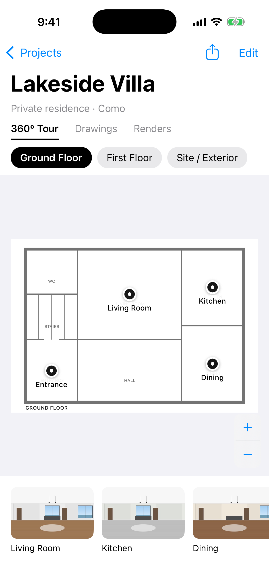

# VIS X

A minimalist iPhone & iPad app for presenting architecture projects — interiors and exteriors —
to clients.



## What it does

Each project has three sections:

| Section | What the client sees |
|---|---|
| **360° Tour** | The plan of each floor (and the site / exterior) with pins. Tap a pin to step inside the 360° view, then tap the doorway markers to walk from room to room. A mini-map shows where you are and lets you jump to any room or floor. |
| **Drawings** | Plans, sections, elevations (PDF or image). Tap to open full screen, pinch to zoom, swipe between sheets. |
| **Renders** | Visualisations of the project, full screen and swipeable. |

The project opens in a clean, view-only mode — ideal to hand the phone to a client.
Tap **Edit** to author:

- **Floors** – add from presets (Basement, Ground Floor, First Floor, … Site / Exterior) or a custom name;
  long-press a floor to rename, reorder, replace its plan or delete it.
- **Plans** – one per floor, image or PDF (first page is used).
- **360° views** – add equirectangular (2:1) images from Photos or Files, select one and tap
  the plan to pin it; drag pins to adjust.
- **Links between rooms** – inside a 360° view tap the link button, turn to face the doorway or
  stairs, tap *Link Here* and choose the destination. Tap a link in Edit mode to remove it.
- **Drawings & renders** – add, rename, delete.

**Share** sends the entire project (floors, plans, 360° views, links, drawings, renders) as one
`.visx` file via AirDrop, Messages, Mail or Files. Opening it on another device with VIS X
imports it.

## Build & run

Requirements: a Mac with Xcode 15+ and [XcodeGen](https://github.com/yonaskolb/XcodeGen)
(`brew install xcodegen`). iOS 16 or later.

```bash
xcodegen generate
open VISX.xcodeproj
```

Select the **VISX** target → *Signing & Capabilities* → your Team, then run on your iPhone.

### Sample project

Launch with the arguments `-VISXDemo YES` (Xcode → *Product › Scheme › Edit Scheme › Arguments*)
to replace the app's content with a generated sample project ("Lakeside Villa"). The images in
it are synthetic placeholders, not real photography. CI uses this mode to capture the screenshots
in [`screenshots/`](screenshots).

## Code layout

```
project.yml                          XcodeGen spec (Info.plist, .visx file type)
VISX/App/VISXApp.swift               App entry; opens received .visx files
VISX/Models/Models.swift             Project, Floor, Panorama, PanoramaLink, ProjectDocument
VISX/Services/ProjectStore.swift     Storage, editing operations, .visx import/export
VISX/Services/ImageProcessing.swift  Thumbnails, downsampling, PDF rendering
VISX/Services/DemoContent.swift      Generated sample project for demos/screenshots
VISX/Views/ProjectListView.swift     Home: project cards
VISX/Views/ProjectView.swift         Project: Tour / Drawings / Renders, Edit, Share
VISX/Views/TourView.swift            Floors, plan with pins, room strip
VISX/Views/FloorPlanViews.swift      Zoomable plan canvas and pins
VISX/Views/PanoramaViewerView.swift  360° viewer, hotspots, mini-map, link editor
VISX/Views/PanoramaSceneView.swift   SceneKit sphere renderer (drag, pinch, gyroscope)
VISX/Views/DocumentsView.swift       Drawings & renders grid with QuickLook
```
